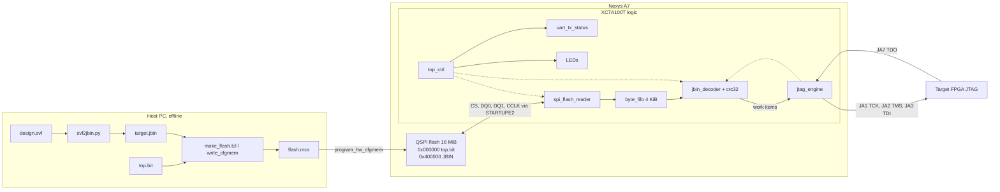
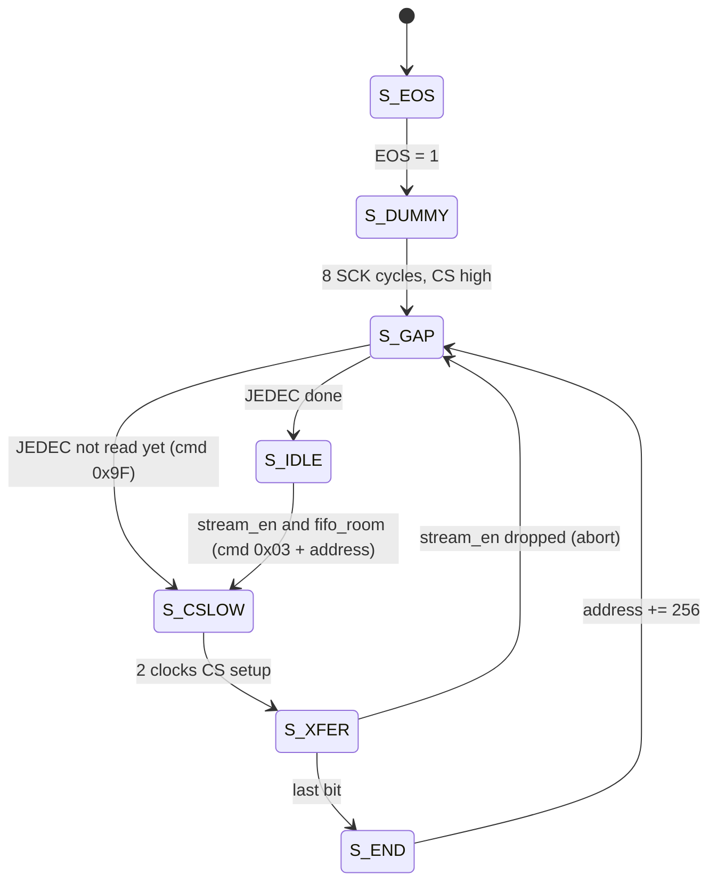
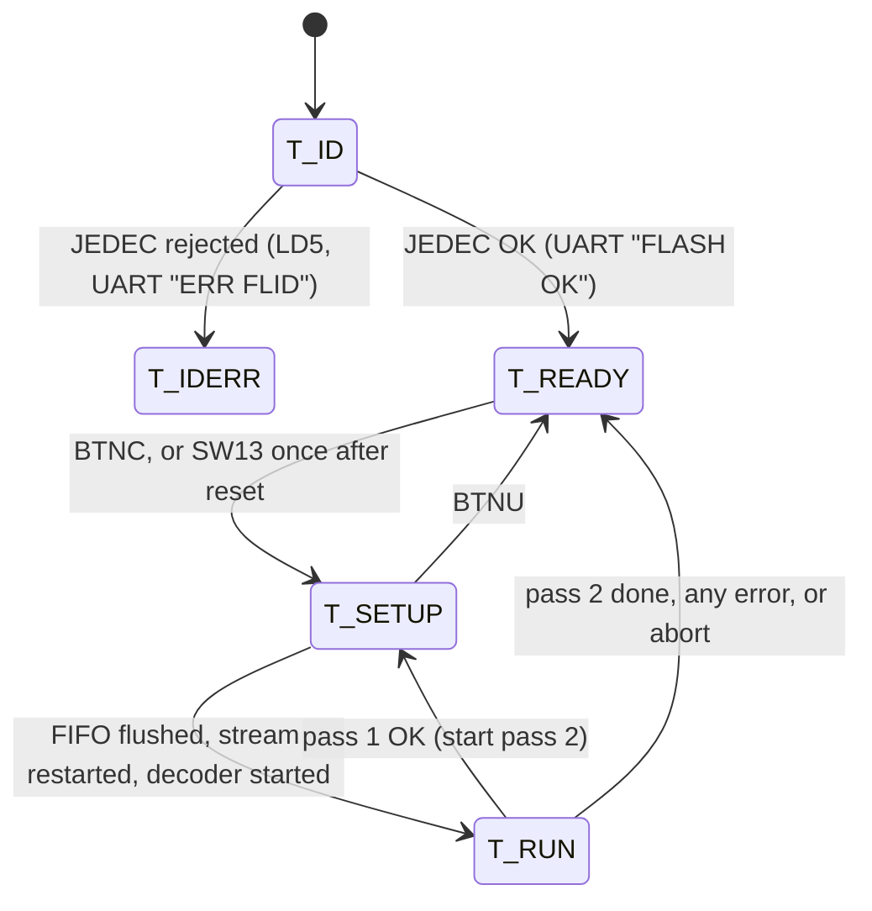
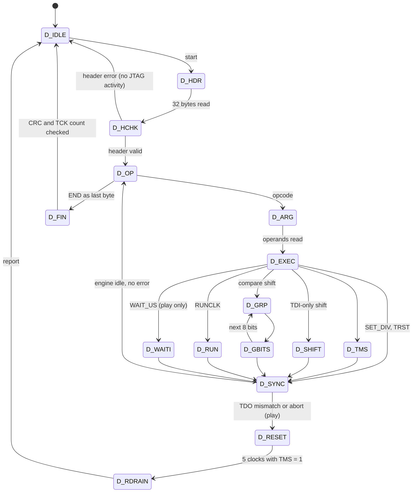

# FPGA-only JTAG programmer: hardware architecture report

This report describes the RTL in `hw/jtag_programmer_fpga_only/rtl/`: what it
is, how it is organised, how data and control move through it, how the flash
memory is accessed, and how fast it is. The JBIN stream format itself is
specified in [jbin_format.md](jbin_format.md); the bring-up procedure is in
[bringup.md](bringup.md).

## 1. Summary

The design replaces the MicroBlaze SVF player with pure logic on the Nexys
A7-100T (XC7A100T). It reads a pre-compiled JTAG command stream (JBIN) from
the on-board configuration flash and replays it on PMOD JA as TCK, TMS and
TDI. While doing so it checks TDO against expected values.

The key design decision: **no SVF text is parsed in hardware.** A host tool
(`tools/svf2jbin.py`) compiles the SVF once. It resolves every TAP state
transition into explicit TMS bits, so the hardware only needs to stream
bytes, decode seven opcodes, shift bits and compare TDO. That keeps the logic
small, deterministic and fully verifiable against the existing software
player. The host-side golden check shows the compiled stream produces a TCK
trace byte-identical to libxsvf for the real 30.7 M-TCK bitstream SVF.

| Property | Value |
|----------|-------|
| Clock domains | One, 100 MHz (`CLK100MHZ`) |
| Processor | None (no MicroBlaze, no soft CPU, no software) |
| External memory | 16 MiB SPI NOR configuration flash only (no DDR) |
| On-chip memory | One 4 KiB byte FIFO (block RAM), a 256-bit header register |
| Flash access | Single-I/O SPI READ (0x03), 25 MHz SCK, 3.07 MB/s |
| TCK | 100 MHz / (2 × half), half ≥ 2: 25 MHz max, 10 MHz default |
| Full programming of an XC7A100T | ≈ 4.5 s at 10 MHz including the check pass (≈ 30–40 s for the MicroBlaze `p` mode) |

## 2. Is it an application-specific processor?

It is best described as a **hard-wired, application-specific stream
processor (a JTAG vector sequencer)**. It has some elements of a processor
but deliberately lacks others.

What makes it processor-like:

- **It has an instruction set.** The JBIN opcodes `TMS`, `SHIFT`, `RUNCLK`,
  `WAIT_US`, `SET_DIV`, `TRST` and `END` are instructions with operands. The
  JBIN file is the program.
- **It has a fetch, decode and execute structure.** The flash reader fetches
  instruction bytes into a prefetch buffer (the FIFO). `jbin_decoder`
  decodes opcodes and operands. `jtag_engine` executes the resulting
  micro-operations ("work items") on the pins.
- **It has architectural state.** That state is the current TCK divider
  (`div_file`), the held TDI value, the sticky TDO-mismatch flag, and the
  TCK counter.
- **It has a two-level decomposition, like microcode.** One `SHIFT` of
  30 million bits is expanded by the decoder into 30 million single-clock
  work items, and the engine executes each one in `2 × half` system clocks.

What it does not have, and why:

| Missing feature | Reason |
|-----------------|--------|
| Program counter with jumps and branches | The program is a strictly linear stream. SVF has no control flow that needs to survive compilation, so the "PC" is simply the flash read address, which only increments. |
| Register file, ALU, data memory | All decisions (TAP walks, masks, bit order, frequencies) are made at compile time on the host. The hardware never computes on data, it only moves it and compares it. |
| Loops | Repetition is encoded as a count (`RUNCLK n`, `SHIFT n`). |
| Interrupts, exceptions, software | Errors are handled by fixed state machine paths: reset the target TAP, then report. |

So it is not Turing-complete and is not programmable in the
general-purpose sense. It is an application-specific instruction-stream
engine in which every "instruction" maps directly onto JTAG pin activity.
This is the property that makes it fast and verifiable. Each TCK cycle
costs exactly `2 × half` system clocks, with no instruction-fetch,
interpreter or bus overhead. That overhead is what limits the MicroBlaze
player, which spends many CPU cycles and AXI GPIO transactions per TCK.

Comparison with the MicroBlaze implementation:

| Aspect | MicroBlaze SVF player | FPGA-only programmer |
|--------|-----------------------|----------------------|
| Where the SVF is interpreted | At run time, in software (libxsvf) | Once, offline on the host (svf2jbin) |
| Per-TCK cost | Software loop plus AXI GPIO writes and reads | 2 × half system clocks, deterministic |
| Program storage | SVF text in memory | Compiled JBIN in QSPI flash |
| Verification | Hardware run only | Golden trace vs libxsvf, plus RTL simulation |
| Typical full-program time | ≈ 30–40 s | ≈ 3.2 s play (+ 1.3 s optional check) at 10 MHz |

## 3. System context and data flow



At power-up the FPGA configures itself from the bitstream at flash address
0x0. After that the same flash becomes a data memory for the logic. The
programmer bitstream and the JTAG program share one device.

## 4. Module hierarchy

```text
top                         rtl/top.sv
├── reset_gen               rtl/reset_gen.sv        power-on reset and CPU_RESETN sync
├── debounce ×8             rtl/debounce.sv         buttons and switches
├── spi_flash_reader        rtl/spi_flash_reader.sv
│   └── flash_sck_startup   rtl/flash_sck_startup.sv (STARTUPE2)
├── byte_fifo               rtl/byte_fifo.sv        xpm_fifo_sync or inferred RAM
├── jbin_decoder            rtl/jbin_decoder.sv
│   └── crc32               rtl/crc32.sv
├── tck_rate_selector       rtl/tck_rate_selector.sv switch/file TCK rate selection
├── jtag_engine             rtl/jtag_engine.sv
├── top_ctrl                rtl/top_ctrl.sv
└── uart_tx_status          rtl/uart_tx_status.sv
```

| Module | Role |
|--------|------|
| `top` | Pin-level wrapper: input debouncing, TCK rate selection wiring, tri-state control of the JTAG pins. |
| `reset_gen` | System reset: 31-cycle power-on counter plus a 2-FF synchronizer for `CPU_RESETN`, giving a registered active-high `rst`. |
| `tck_rate_selector` | Converts the debounced switch setting into a TCK half period and applies it as a speed limit to the JBIN/SVF request, unless overridden. |
| `top_ctrl` | System controller: sequencing of the check pass and the play pass, abort, LEDs, UART messages. |
| `spi_flash_reader` | Flash bus master: dummy clocks, JEDEC ID check, block-wise streaming read with flow control. |
| `flash_sck_startup` | Drives the dedicated CCLK pin through `STARTUPE2.USRCCLKO`. |
| `byte_fifo` | Elastic buffer between the bursty flash and the steady JTAG consumer. |
| `jbin_decoder` | Instruction decoder and checker: header, opcodes, operands, CRC, TCK count, error policy. |
| `crc32` | Byte-wise CRC-32 (zlib-compatible), one byte per cycle. |
| `jtag_engine` | Execution unit: TCK generation, TMS/TDI update, TDO sampling and compare, microsecond waits. |
| `uart_tx_status` | 115200 baud status line printer, no CPU. |
| `debounce` | 2-FF synchronizer plus a 10 ms stability filter. |

## 5. Clocking and reset

- **Single clock.** Everything runs on the 100 MHz board clock. The flash
  SCK (25 MHz) and TCK (≤ 25 MHz) are not clocks inside the FPGA. They are
  data outputs toggled by registers, so there are no clock domain crossings
  and no derived-clock constraints.
- **Asynchronous inputs.** TDO and flash MISO each pass through an IOB
  register plus one more flip-flop where needed. Buttons and switches pass
  through `debounce`, which has two synchronizer flip-flops.
- **Reset.** `rst` comes from `reset_gen` and is synchronous and active
  high. It is asserted for 31 cycles after configuration (power-on counter,
  `POR_CYCLES`) and whenever `CPU_RESETN` is low (2-FF synchronizer marked
  `ASYNC_REG`). Assertion and release both happen on a clock edge.
- **IOB registers.** Every timing-critical pin is driven or sampled by a
  register packed into the I/O block: TCK, TMS, TDI, TDO, CS, MOSI and MISO
  (`(* IOB = "TRUE" *)` and the XDC `IOB TRUE`). Pin timing is then fixed by
  silicon, not by routing, and `build.tcl` fails if packing did not happen.

## 6. Data path

### 6.1 Widths and rates per stage

```text
flash --1 bit @ 25 MHz--> spi_flash_reader --8 bit, 1 byte / 32 clk--> byte_fifo
byte_fifo --8 bit FWFT, ≤ 1 byte / clk--> jbin_decoder --1 work item / TCK--> jtag_engine
jtag_engine --TCK/TMS/TDI @ ≤ 25 MHz--> target --TDO--> jtag_engine
```

| Stage | Format | Peak rate |
|-------|--------|-----------|
| Flash to reader | Serial, MSB first per byte | 25 Mbit/s raw; 3.07 MB/s sustained (256-byte blocks, 32-bit command overhead) |
| Reader to FIFO | Byte, write strobe | 1 byte per 32 clocks during a burst |
| FIFO to decoder | Byte, first-word fall-through | 1 byte per clock |
| Decoder to engine | Work item: TMS, TDI, hold, check, expected TDO, or a wait | 1 item per TCK (2 × half clocks) |
| Engine to pins | TCK, TMS, TDI | 25 MHz at half = 2 |

### 6.2 Bit-level data path inside the decoder

For a TDI-only `SHIFT`, which carries 99.6 % of the reference bitstream,
the decoder does not copy data bytes into a register. It **peeks** at the
FIFO output (`fifo_dout`, valid while the FIFO is not empty) and selects
bit `bi[2:0]` as TDI. The byte is popped together with the transfer of its
last bit. The next byte is therefore already on the FIFO output when the
engine asks for the next bit, so there is no stall between bytes even at
25 MHz TCK.

For a compare `SHIFT`, each group of 8 bits needs three bytes (TDI, expected
TDO, mask). The decoder loads them into `g_tdi`, `g_tdo` and `g_msk` in three
cycles, then issues the 8 bits. This costs three clocks per 8 bits, and is
used for only 34 bits in the reference SVF.

`TMS` opcodes (state walks) use the same peek mechanism as TDI-only shifts,
with TDI held.

### 6.3 Work item format (decoder to engine)

| Signal | Meaning |
|--------|---------|
| `e_valid` / `e_ready` | Handshake; transfer when both are 1 |
| `e_wait` | 0: one TCK cycle; 1: wait `e_us` microseconds with TCK high |
| `e_tms`, `e_tdi` | Pin values for this clock |
| `e_hold` | 1: keep the previous TDI (libxsvf `tdi = -1`) |
| `e_chk`, `e_exp` | Compare TDO of this clock against `e_exp` |
| `e_us` | Wait time |
| `e_cancel` | Abort request; ends a running wait |
| `e_idle`, `e_err`, `e_err_tck` | Engine status back to the decoder |

## 7. Memory access

### 7.1 Flash memory map

| Address range | Content |
|---------------|---------|
| 0x000000 – 0x3FFFFF | Programmer bitstream `top.bit` (compressed; an uncompressed XC7A100T bitstream is ≈ 3.8 MB and also fits) |
| 0x400000 – 0xFFFFFF | JBIN stream: 32-byte header plus payload (up to 0xBFFFE0 bytes). The reference stream is 3,826,052 bytes. |

`make_flash.tcl` builds this image with
`write_cfgmem -loadbit "up 0x0 top.bit" -loaddata "up 0x400000 flash_data.bin"`,
checks the sizes, and verifies the MCS with `tools/check_mcs.py` before
programming.

### 7.2 Physical access path

- **CCLK.** On 7-series devices the configuration clock pin is dedicated
  and is only reachable from logic through `STARTUPE2.USRCCLKO`.
  `flash_sck_startup` instantiates it with `USRCCLKTS = 0` (drive CCLK),
  `KEYCLEARB = 1` (never clear the AES key), and DONE left to the
  configuration logic. Its `EOS` output (end of startup) tells the reader
  when the flash may be used.
- **CS, DQ0 (MOSI), DQ1 (MISO).** These are ordinary user I/O (L13, K17,
  K18) once configuration has finished.
- **DQ2 and DQ3.** Driven high: write protect off, HOLD/RESET inactive.
  They are not used for data, because single-I/O READ is fast enough (see
  section 10).

### 7.3 SPI protocol and timing

The SPI mode is mode 0: SCK idles low, the flash samples MOSI on the rising
edge and drives MISO after the falling edge. One bit takes four system
clocks (40 ns):

```text
phase      ph0      ph1      ph2      ph3      ph0 ...
SCK      ___________________/‾‾‾‾‾‾‾‾‾‾‾‾‾‾‾‾‾\______
MOSI     X=== bit n ===========================X== n+1
MISO     ==X (flash drives after the SCK fall) =====
sample                              ^ IOB register at the start of ph3
                                      (30 ns after the fall)
```

- MOSI changes at the start of phase 0, giving 20 ns of setup before the
  rising edge.
- MISO is captured by the IOB register 30 ns after the SCK falling edge.
  This covers the STARTUPE2 CCLK delay (a few ns) plus the flash
  clock-to-output time (8 ns for the S25FL128S). In simulation the reader
  still works with a flash output delay of 24 ns plus a 3 ns CCLK delay,
  and fails at 28 ns, which confirms where the sampling point is.

### 7.4 Reader state machine



1. **Dummy clocks.** STARTUPE2 swallows the first three USRCCLKO edges
   after configuration, so the reader sends eight SCK cycles with CS high.
2. **JEDEC ID.** One `0x9F` command. It is accepted if the manufacturer byte
   is neither 0x00 nor 0xFF and the capacity code is 0x17–0x20 (64 Mbit or
   larger). The ID is printed on the UART; failure lights LD5.
3. **Streaming.** While `stream_en` is 1 the reader issues
   `0x03 <24-bit address>`, receives exactly 256 bytes, raises CS for eight
   cycles (CS high time between commands), and advances the address by 256.
   `start_addr` is sampled each time `stream_en` rises, so every pass
   restarts at 0x400000.

### 7.5 Flow control: why the FIFO cannot overflow

A read block is started only when `fifo_room` is 1. That signal means at
least `ROOM = 320` bytes are free, which is more than the 256 bytes of a
block. `room` is registered and lags by a cycle, and the XPM
`wr_data_count` may include the FWFT output stage. The 64-byte margin
absorbs both effects. Only one block is in flight at a time. Writes
therefore never hit a full FIFO, so the SPI clock never has to stop in
the middle of a byte.

When the FIFO runs empty (the consumer is faster than the flash), the
decoder simply stops offering work items and TCK stays high. JTAG is fully
static, so a pause of any length between clocks is harmless.

### 7.6 On-chip memory

| Memory | Size | Implementation |
|--------|------|----------------|
| `byte_fifo` | 4096 × 8 bit | `xpm_fifo_sync`, block RAM, FWFT (synthesis default); inferred memory option `USE_XPM = 0` for simulators without XPM |
| Header register | 256 bit | Flip-flops in `jbin_decoder`, filled by shifting in the first 32 stream bytes |
| Compare group | 3 × 8 bit | Flip-flops in `jbin_decoder` |
| TDO compare pipeline | 2 entries × (1 + 1 + 64 bit) | Flip-flops in `jtag_engine` |

There is no external RAM and no frame buffer. The whole 3.8 MB program is
consumed as a stream, and the FIFO only smooths out the flash's
block-oriented delivery.

## 8. Control path

### 8.1 System state machine (`top_ctrl`)



- **Pass 1 (check).** The decoder runs with `dry = 1`. Every work item is
  accepted immediately and nothing reaches the pins, which stay high
  impedance. The pass reads the whole stream, so it checks the header, every
  opcode and operand, the END position, the payload CRC-32 and the total TCK
  count. It takes about 1.25 s, limited by the flash.
- **Pass 2 (play).** Only after pass 1 succeeds (or when SW14 skips it) are
  the JTAG outputs enabled (`jtag_oe`) and the stream played.
- **Setup.** Each pass starts with 64 setup cycles: `stream_en` low, the
  FIFO in reset for 16 cycles, then the engine cleared so the pins come up
  as TCK = 1, TMS = 1, TDI = 0.
- **Abort.** BTNU sets `abort_req`. The decoder stops issuing items at once,
  cancels a running wait, waits for the engine to go idle, sends the target
  TAP to Test-Logic-Reset with five TMS = 1 clocks, then reports `ABORT`.

### 8.2 Decoder state machine (`jbin_decoder`)



- **Opcode boundaries.** After every opcode the decoder waits (`D_SYNC`)
  until the engine is idle, including the TDO compare pipeline. Only then
  does it look at the sticky mismatch flag. Errors are therefore detected
  at a well-defined point, at most one opcode after the failing bit. The
  error report carries the exact TCK index of the first mismatch. The
  reference SVF has only a few hundred opcodes, so this drain costs
  practically nothing.
- **Error policy.**
  - In pass 1, a format error does not stop the pass immediately. The
    decoder drains the rest of the payload (`D_DRAIN`) so that the CRC can
    decide: if the CRC is wrong, it reports `ERR CRC`, because corruption
    explains the format error.
  - In pass 2, any error first resets the target TAP (`D_RESET`).
  - Header errors never produce JTAG activity.
- **Watchdog.** If the decoder waits more than 0.5 s for a byte, it reports
  `ERR TOUT`.

## 9. Communication paths

### 9.1 Internal interfaces

| From | To | Interface | Protocol |
|------|----|-----------|----------|
| `top_ctrl` | `spi_flash_reader` | `stream_en`, `start_addr` | Level: stream while high, restart on each rise |
| `spi_flash_reader` | `top_ctrl` | `id_done`, `id_ok`, `jedec_id` | Level, set once after power-up |
| `spi_flash_reader` | `byte_fifo` | `fifo_wr`, `fifo_din`; `fifo_room` back | Write strobe; credit-style room flag |
| `byte_fifo` | `jbin_decoder` | `fifo_dout`, `fifo_empty`; `fifo_rd` back | First-word fall-through: data valid while not empty, `rd` pops |
| `top_ctrl` | `jbin_decoder` | `dec_start` (pulse), `dec_dry`, `dec_abort` (level) | Command |
| `jbin_decoder` | `top_ctrl` | `done` (pulse), `status`, `err_info`, `hdr_valid`, `total_tck`, `tck_issued` | Result and progress |
| `jbin_decoder` | `jtag_engine` | Work items (section 6.3) | valid/ready handshake |
| `jtag_engine` | `jbin_decoder` | `idle`, `err`, `err_tck` | Status |
| `top` | `jtag_engine` | `half` (TCK half period), `clear` | Latched by the engine at every falling edge |
| `top_ctrl` | `uart_tx_status` | `uart_send` (pulse), `code`, `info` | Command |

### 9.2 External interfaces

| Interface | Pins | Direction | Notes |
|-----------|------|-----------|-------|
| JTAG master | JA1 TCK, JA2 TMS, JA3 TDI | Out, tri-state | Driven only during pass 2, otherwise high impedance with pull-ups; DRIVE 8, SLEW SLOW to limit ringing on the cable |
| JTAG TDO | JA7 | In | Pull-up; IOB register plus one synchronizer stage |
| Configuration flash | L13 CS, K17 DQ0, K18 DQ1, L14 DQ2, M14 DQ3, CCLK via STARTUPE2 | Out / in | SPI mode 0, 25 MHz |
| USB-UART | D4 | Out | 115200 8N1, status lines only |
| User I/O | BTNC, BTNU, CPU_RESETN, SW[2:0], SW13–15, LD0–15 | In / out | See bringup.md |

## 10. JTAG execution unit (`jtag_engine`)

### 10.1 TCK generation

The engine has four states: idle, low, high and wait. A clock item that is
accepted starts a falling edge: TCK goes to 0 while TMS and TDI take their
new values, all in the same IOB clock edge. TCK stays low for `half`
cycles and high for `half` cycles. The target samples TMS and TDI on the
rising edge, at least `half × 10 ns` after they changed.

```text
system clk  |_|‾|_|‾|_|‾|_|‾|_|‾|_|‾|_|‾|_|‾|_|‾|    (half = 2: 25 MHz)
TCK         ‾‾‾‾\_______/‾‾‾‾‾‾‾\_______/‾‾‾‾‾‾‾
TMS/TDI     ====X===============X===============
TDO (target)  ==X=== launched after the fall ===X==
TDO sample                     ^ captured at the edge that ends the cycle
```

An item is accepted when the engine is idle or in the last cycle of a high
phase (`item_ready`). Back-to-back items therefore give a continuous TCK
with no gaps. If no item is ready, TCK simply stays high. The half period
is latched at each falling edge, so `SET_DIV` takes effect exactly at an
opcode boundary.

### 10.2 TDO sampling and compare

- The target launches TDO on the falling edge.
- The engine's IOB register captures TDO at the system clock edge that ends
  the TCK cycle. That is the latest moment before the next falling edge
  reaches the pin, which gives the cable and the target the whole cycle
  (40 ns at 25 MHz, 100 ns at 10 MHz) for the round trip.
- A second flip-flop synchronizes the value.
- A two-stage delay line (`TDO_LAG = 2`) carries each clock's check flag,
  expected value and TCK index, so they meet the synchronized sample.
- The first mismatch is sticky and records its 0-based TCK index
  (`err_tck`).

In simulation, a 35 ns TDO delay at 25 MHz passes, and a 45 ns delay fails,
as it must.

### 10.3 Waits

`WAIT_US` items keep TCK high and count microseconds with a /100 prescaler.
This implements SVF `RUNTEST ... SEC`, for example the 100 ms wait after
JPROGRAM in the reference SVF. `cancel_wait` ends a wait early on abort.

### 10.4 TCK frequency selection

`tck_rate_selector` computes and registers the half period every cycle:

```text
half = SW15 ? half_sw : max(half_sw, div_file)
half_sw from SW[2:0]: 5, 50, 10, 4, 3, 2, 500, 5000  (10 MHz, 1 MHz, 5 MHz,
                      12.5 MHz, 16.7 MHz, 25 MHz, 100 kHz, 10 kHz)
div_file: last SET_DIV of the stream (from SVF FREQUENCY), default 5
```

Without SW15 the board never clocks faster than the SVF asks. With SW15 the
switches alone decide, which is how speeds above the SVF's 10 MHz are tried.

## 11. Integrity and error handling

| Check | Where | Status code |
|-------|-------|-------------|
| Flash JEDEC ID plausible | `spi_flash_reader` | 10 `ERR FLID` |
| Magic, version, flags, reserved, header CRC, payload length | `jbin_decoder` D_HCHK | 3 `ERR HDR` |
| Unknown opcode; END not the last byte | D_OP | 4 `ERR OPC` |
| Opcode runs past `payload_len` | D_OP, D_ARG, bit states | 5 `ERR OVR` |
| Payload CRC-32 | D_FIN, D_DRAIN | 6 `ERR CRC` |
| Clocks issued ≠ header `total_tck` | D_FIN | 7 `ERR TCK` |
| Zero-length TMS, bad SHIFT flags, SET_DIV < 2 | D_EXEC | 9 `ERR ARG` |
| Flash stream stalled for 0.5 s | Watchdog | 11 `ERR TOUT` |
| TDO differs from the expected value under the mask | `jtag_engine` | 2 `ERR TDO` |
| User abort | `top_ctrl` | 8 `ABORT` |

These checks are the same as those in `tools/jbin_model.py`, so a stream
the model accepts is accepted by the hardware and vice versa. The decoder
testbench checks this for 17 valid and invalid streams.

## 12. Performance

For the reference stream: 30,716,788 TCK, 3,826,052 bytes, one 100 ms wait.

| Phase | 1 MHz TCK | 10 MHz TCK (default) | 25 MHz TCK |
|-------|-----------|----------------------|------------|
| Pass 1 (flash-limited, 3.07 MB/s) | 1.25 s | 1.25 s | 1.25 s |
| Pass 2 shifting | 30.7 s | 3.07 s | ≈ 1.25 s (flash-limited) |
| Pass 2 wait | 0.1 s | 0.1 s | 0.1 s |
| **Total** | ≈ 32 s | **≈ 4.4 s** (≈ 3.2 s with SW14) | ≈ 2.6 s (≈ 1.35 s with SW14) |

Bottleneck analysis:

- **Up to about 24 MHz TCK, the engine is the limit.** The stream needs
  TCK / 8 bytes per second: 1.25 MB/s at 10 MHz, well under the 3.07 MB/s
  the flash delivers.
- **At 25 MHz TCK, the stream needs 3.13 MB/s.** That is slightly more than
  single-I/O SPI at 25 MHz SCK delivers. TCK then pauses briefly whenever
  the FIFO runs dry, which is harmless.
- **Possible upgrades to remove the flash limit:**
  - Quad Output Read (0x6B) on DQ0–3: about 4× the read rate, using pins
    that are already connected.
  - A faster SCK of 50 MHz with a different sampling phase.
- **Decoder overhead** is zero for TDI-only data, thanks to the peek path.
  It is three clocks per 8 compared bits, and a few clocks per opcode
  boundary.

## 13. Resource expectations

The design has not been synthesized on this machine (Vivado not installed);
`scripts/build.tcl` writes the exact figures to `build/utilization.rpt`. The
expected order of magnitude, from the structure of the RTL:

| Resource | Expected use |
|----------|--------------|
| Block RAM | 1 RAMB36 (4096 × 8 FIFO) |
| Flip-flops | Roughly 1,000: the 256-bit header register, the 64-bit counters and thresholds, the counters and state machines |
| LUTs | Roughly 1,000–2,000: the comparators for the progress bar, the CRC logic, the multiplexers |
| DSP, MMCM, PLL | None |
| Primitives | STARTUPE2 ×1 |

This is a small fraction of the XC7A100T (63,400 LUTs, 135 RAMB36). The
MicroBlaze design needs a CPU, local memory, an AXI interconnect and GPIO
peripherals for the same job.

## 14. Verification

| Level | What | Result |
|-------|------|--------|
| Converter vs libxsvf | `tools/golden/run_golden.py`: per-TCK trace and wait/frequency events of libxsvf against `svf2jbin` + `jbin_model`, for `nexys_a7_01.svf` and three feature SVFs | Byte-identical (30.7 M TCK) |
| Flash reader | `sim/tb_spi_flash_reader.sv` against a behavioral SPI flash with X between the hold and valid times | Data correct, 3.07 MB/s, margin up to a 24 ns flash delay |
| Engine | `sim/tb_jtag_engine.sv`: random items, half periods, stalls, waits; TDO round trip delay | Exact timing, exact mismatch index |
| Decoder | `sim/tb_jbin_decoder.sv`: 17 streams × 2 passes, random back-pressure | Trace-exact vs model, all error codes |
| System | `sim/tb_top.sv`: flash model, `top`, IEEE 1149.1 TAP model of a 7-series target; 10 scenarios (programming with DONE, TDO fault, CRC/header faults, skip check, abort, flash ID error, FIFO stalls, auto start, frequency switches) | All pass; mutation tests (inverted TDI, lost Exit1 TMS) are detected |

The suite runs in Vivado xsim (`sim/run_sim.tcl`, with the XPM FIFO) or in
Icarus Verilog (`sim/run_icarus.py`, inferred FIFO). So far it has run in
Icarus only.

## 15. Limitations and possible extensions

- **One target, no TRST.** The design has no TRST pin and supports a single
  JTAG chain. `HIR`/`TIR`/`HDR`/`TDR` padding for multi-device chains is
  supported, because the compiler folds it into the shifts.
- **No readback.** TDO is only compared, never stored. A failing bit is
  identified by its TCK index, which `jbin_model.py --trace` can map to
  the opcode and bit that produced it.
- **One program at a time.** The flash holds one JBIN at 0x400000. Several
  images, selected by switches, would only need a different `start_addr`
  per switch setting.
- **Speed above 25 MHz.** This would need `half = 1` (a 50 MHz TCK, which
  is beyond typical cable and target limits) or a faster system clock. The
  flash path would need a quad read first.
- **Hardware not yet exercised.** The steps are in [bringup.md](bringup.md).
