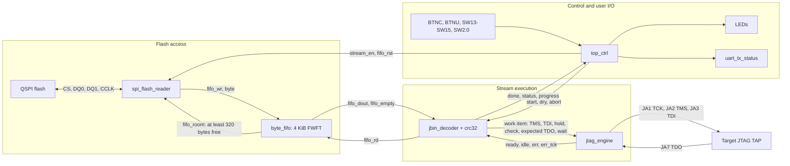
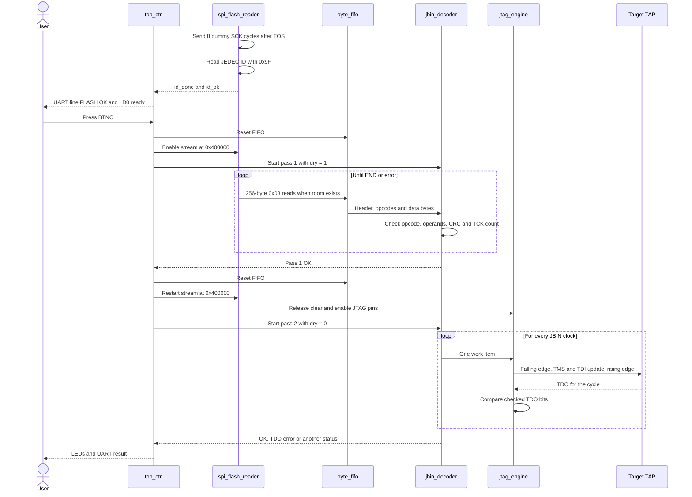
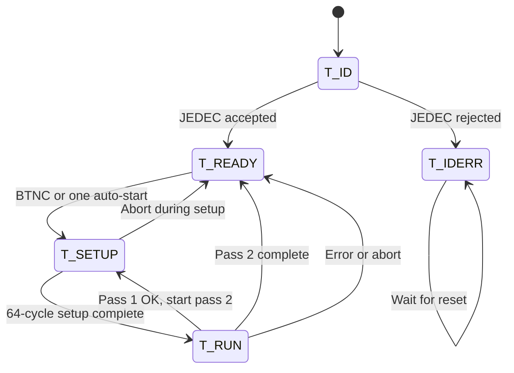
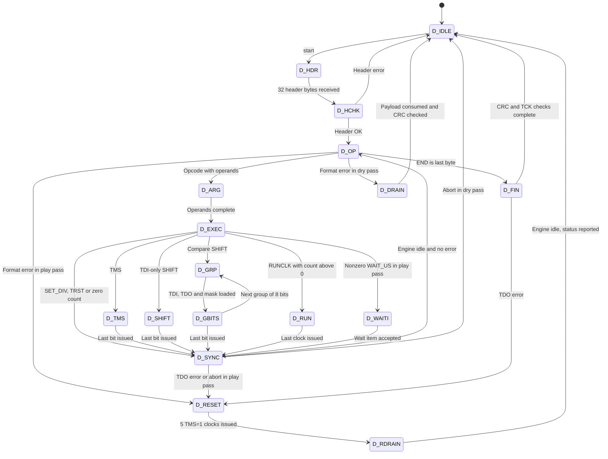
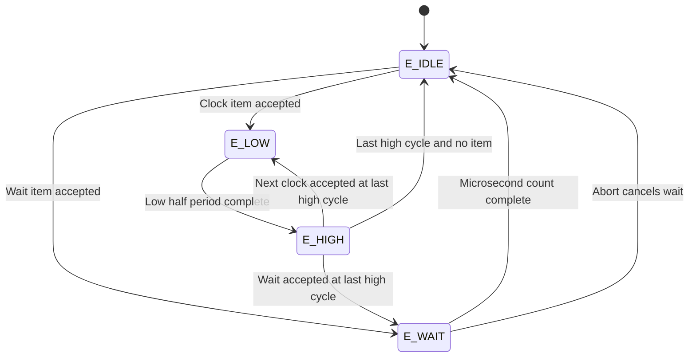
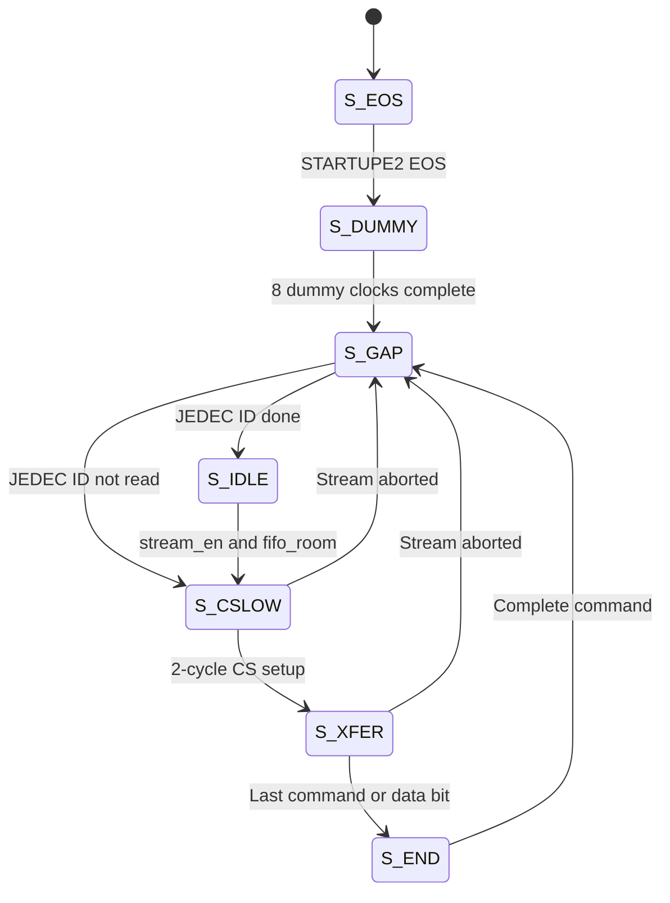
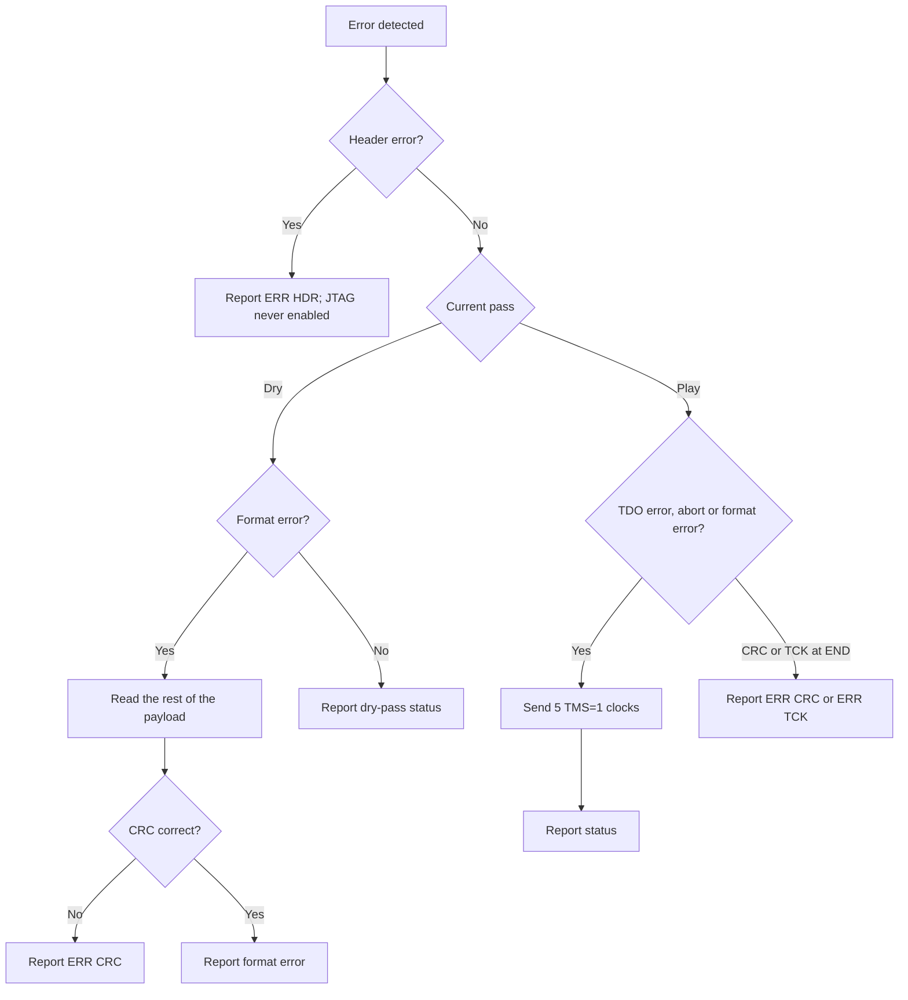

# FPGA-only JTAG programmer diagrams

The design is a linear pipeline. The flash reader fills a FIFO, the decoder turns JBIN bytes into one-clock JTAG work items, and the engine drives the PMOD pins. `top_ctrl` runs each stream twice: first a dry pass that checks the stream with the pins released, then a play pass that drives the target.

## End-to-end flow

```mermaid
flowchart LR
    svf["Target SVF"] --> conv["svf2jbin.py: resolve TAP walks, masks, waits and frequency"]
    conv --> jbin["target.jbin"]
    bit["top.bit"] --> mcs["make_flash.tcl: write_cfgmem"]
    jbin --> mcs
    mcs --> flash["QSPI flash: top.bit at 0x000000, JBIN at 0x400000"]
    flash --> boot["Power-up: FPGA configures from top.bit"]
    boot --> ready["Programmer ready"]
    ready --> check["Pass 1: read whole JBIN, no JTAG activity"]
    check --> ok{"Stream valid?"}
    ok -->|"No"| report["Show error on LEDs and UART"]
    ok -->|"Yes"| play["Pass 2: replay JBIN on JTAG pins"]
    play --> target["Target FPGA receives configuration"]
    target --> result["Show result on LEDs and UART"]
```



## Data and control blocks



## Programming sequence



## `top_ctrl` state machine



| State | Main actions |
|---|---|
| `T_ID` | Wait for the flash JEDEC result. |
| `T_READY` | Release the JTAG pins, keep the FIFO reset, and wait for a start. |
| `T_SETUP` | Reset the FIFO for 16 cycles, restart the flash stream, and start the decoder. |
| `T_RUN` | Run either the dry pass or the play pass. |
| `T_IDERR` | Remain stopped until reset. |

## `jbin_decoder` state machine



Two paths matter most. A TDI-only `SHIFT` takes TDI bits directly from the current FIFO byte, so long shifts continue without per-byte stalls. A compare `SHIFT` loads three bytes for each 8-bit group (TDI, expected TDO, mask), then issues the eight checked clocks.

## `jtag_engine` state machine



```text
TCK      ‾‾‾‾‾\_____________/‾‾‾‾‾‾‾‾‾‾‾‾‾‾\______
TMS/TDI  ======X===========================X=====
TDO      ========X target response for cycle===X
Sample                                        ^ IOB capture before next fall
Compare                                          ^^ two clocks later
```

The engine holds TCK low for `half` system clocks, then high for `half` system clocks. With the 100 MHz clock, `half = 5` gives 10 MHz and `half = 2` gives 25 MHz.

## `spi_flash_reader` state machine



```text
One SPI bit = 4 system clocks = 40 ns

Phase    ph0     ph1     ph2     ph3
SCK      0       0       1       1
MOSI     changes at ph0
MISO     flash drives after the SCK fall
Sample   IOB register captures at the start of ph3
```

## Error handling


